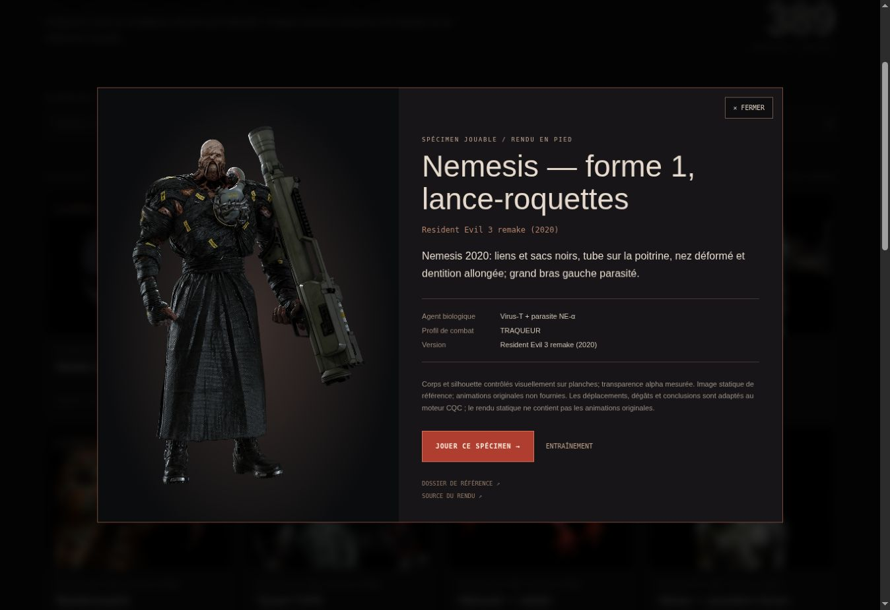
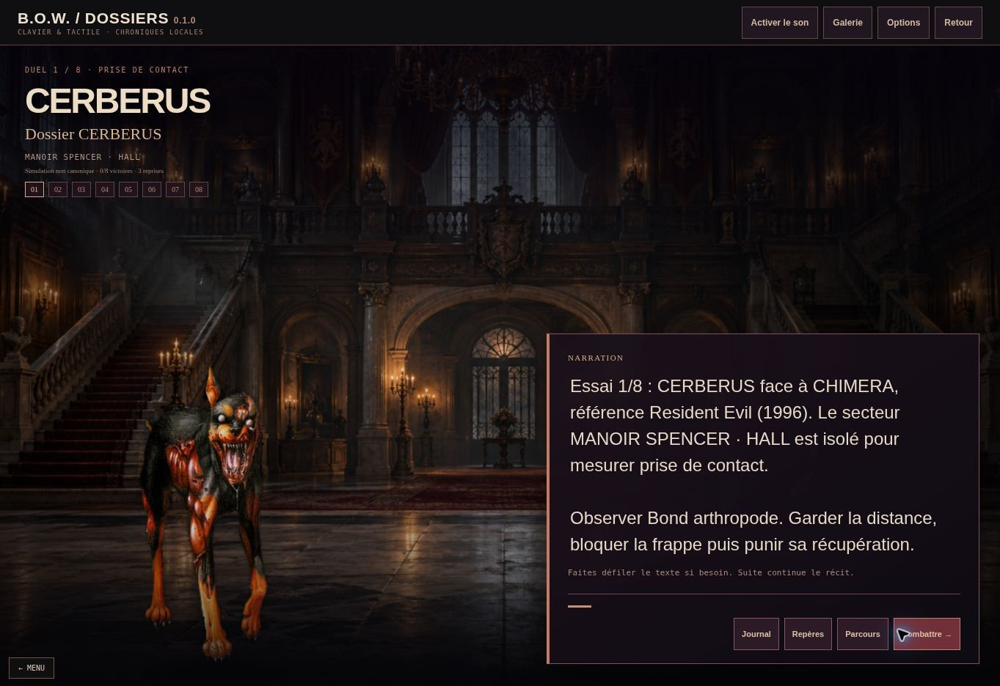
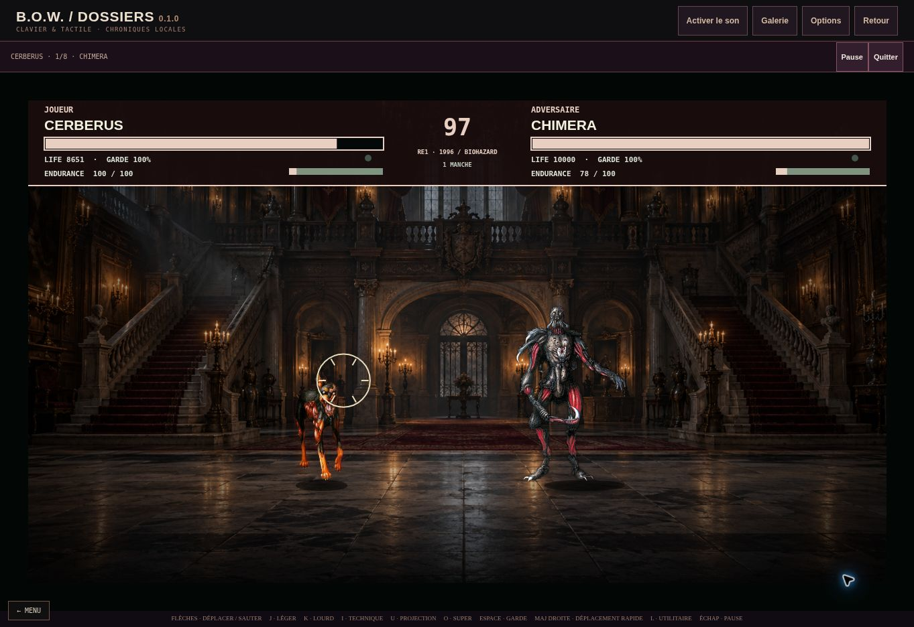

# Contrôle navigateur — Bestiaire et Dossiers

## Résultat observé

Le filtre des **75 spécimens jouables**, la fiche de Nemesis, sa fermeture et le parcours **Cerberus → prologue → précombat → combat contre Chimera** fonctionnent dans le navigateur réel. Aucun défaut bloquant ni erreur JavaScript provenant du site n’a été observé sur ce parcours.

Contrôle effectué le **10 octobre 2026**, vers **16 h 49–16 h 54 UTC**, sur la publication annoncée `dpl_CAHW5yN2b2sxbAg2YD5oDUgi9Uwi` et son alias de production. Les pages ont été parcourues par leurs contrôles visibles dans un onglet Chrome indépendant. Les lectures JavaScript ont été limitées au DOM : dimensions, état de la boîte de dialogue, chargement d’image, visibilité et iframe. Aucun appel à l’API interne du moteur n’a servi à produire les résultats.

Pages réellement ouvertes :

- [Bestiaire](https://resident-evil-bow-protocol.vercel.app/codex.html)
- [Dossiers de confinement](https://resident-evil-bow-protocol.vercel.app/modules/chronicles.html)

## Bestiaire

| Action | Observation réelle |
| --- | --- |
| Ouverture | **389 dossiers · 75 jouables**, pagination **1 / 17**. |
| Filtre « SPÉCIMENS JOUABLES » | **75 dossiers · 75 jouables**, pagination **1 / 4**. |
| Ouverture de « Nemesis — forme 1, lance-roquettes » | Fiche de la version **Resident Evil 3 remake (2020)**, image en pied chargée à **684 × 1055 px**, informations biologiques et deux liens de sources visibles. |
| Présentation de la fiche | Boîte de dialogue de **1050 × 667 px**, entièrement contenue dans la zone visible. Aucun débordement horizontal. |
| Fermeture | La boîte de dialogue se ferme, le focus revient à la carte de Nemesis et le filtre reste à **75 / 75**. |

La grille à quatre colonnes, ses textes, les boutons et la fiche sont lisibles sur la surface de bureau observée. Le défilement vertical du Bestiaire laisse une largeur utile de **1348 px** sur une capture de **1363 × 936 px**.

## Dossiers de confinement

La sélection affiche **75 / 75** dossiers. Le dossier Cerberus est proposé avec son image, le décor Spencer, son bouton « Commencer » et le compteur de fins débloquées. Le prologue se déroule sur **trois pages**, puis « Entrer dans le parcours » ouvre le premier précombat.

Ce précombat annonce **Duel 1 / 8 — Prise de contact**, **Cerberus contre Chimera**, **0 / 8 victoires** et **3 reprises**. Les huit repères de progression sont visibles. Le texte, le personnage, les boutons de journal/parcours et « Combattre » restent lisibles sans superposition gênante sur la surface observée.

« Combattre » charge l’iframe réelle `modules/versus.html?embed=story55`. Le décor Spencer et les deux spécimens apparaissent. Les boutons parent « Pause » et « Quitter » restent accessibles ; l’iframe occupe **1363 × 804 px**, à **x = 0, y = 108**, sans débordement horizontal.

Deux observations du Canvas confirment la progression du moteur : le chrono passe de **99 à 97**, Cerberus de **10000 à 8651 points de vie**, et Chimera affiche **78 / 100 d’endurance**. Les positions changent et un effet d’impact apparaît. Ces valeurs ont été lues sur les captures du combat, sans consulter l’état interne de la simulation.

## Console et limites

Les **31 entrées d’erreur ou d’avertissement** disponibles à la dernière lecture provenaient du script d’une extension Chrome (`Error sending browser metadata to extension`). Aucune entrée provenant de l’application n’a été relevée pendant cette séquence. Les erreurs d’extension sont distinguées des erreurs du produit.

Cette vérification couvre un navigateur de bureau, un filtre du Bestiaire, une fiche et le démarrage d’un Dossier jusqu’à un duel effectivement animé. Elle ne valide pas les huit victoires d’un parcours, toutes les fiches, le mobile, les commandes tactiles ou une manette physique. Les panneaux F1/F2 n’ont pas été ouverts dans cet onglet ; leur correctif et leur nouvelle publication relèvent du contrôle d’intégration séparé. Ce rapport complète les **26 + 20 vérifications automatisées** documentées dans [VERIFICATION_FR.md](VERIFICATION_FR.md), sans les remplacer ni présenter leur exécution comme des observations de navigateur.
