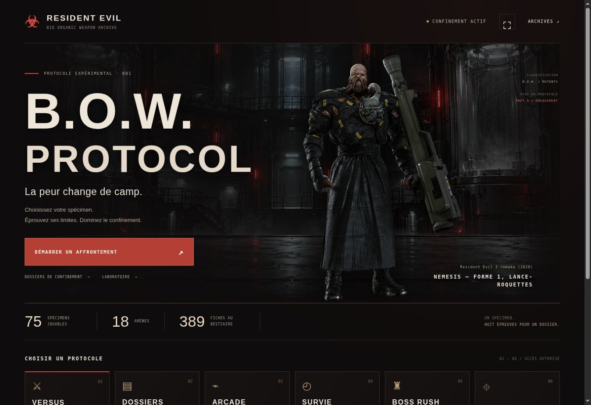
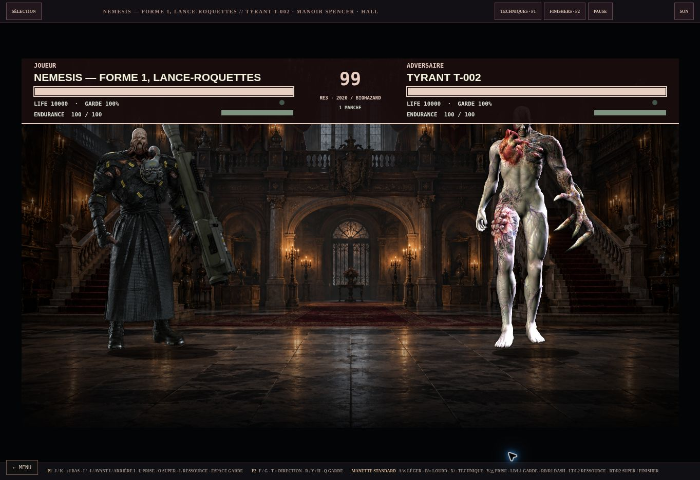
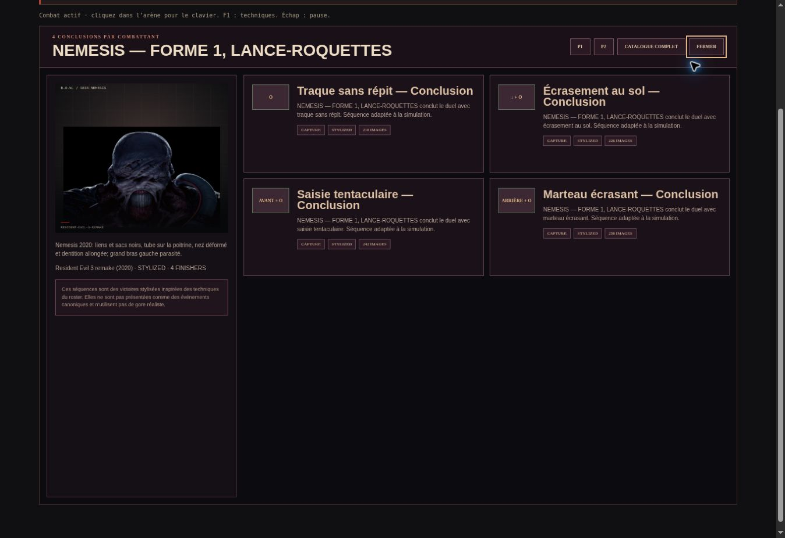

# Vérification navigateur — B.O.W. Protocol 0.1.0

## Résultat

Le site de production est accessible à l’adresse **https://resident-evil-bow-protocol.vercel.app/**. Le déploiement de jeu validé est `dpl_9rd15MrH1PU3tTGFqjmCDLZU4DP2`, déclaré READY par Vercel le 10 octobre 2026. La construction a contrôlé la présence des ressources de 75 spécimens, 389 références et 18 configurations d’arène.

Les contrôles ci-dessous ont été effectués dans Chrome, sur une surface de bureau d’environ 1363 × 936 pixels. Ils utilisent les éléments visibles et les commandes de l’interface, sans remplacer les résultats du moteur.

| Parcours | Observation réelle |
|---|---|
| Accueil | Identité, Nemesis en pied, décor, liens de modes et compteurs 75 / 18 / 389 affichés ; image chargée et aucun débordement horizontal. |
| Versus | Sélection de Nemesis 2020 contre Tyrant T-002, une manche, chargement du manoir Spencer et des deux corps entiers. |
| Combat actif | Chronomètre observé à 93 ; vie de Nemesis descendue à 6510 / 10000, Tyrant à 10000 avec 46 / 100 d’endurance ; positions des combattants modifiées. |
| Pause et répertoires | Pause/reprise accessibles ; répertoire de Nemesis et ses dix techniques ; quatre conclusions affichées. |
| Arcade | Lancement confirmé par « Combat actif » et « Rencontre 1 / 8 » dans la page ; iframe native du vrai module Versus chargée. |
| Clavier dans l’iframe | Clic dans le Canvas, puis F1 et F2 : dialogues techniques et finishers visibles ; fermeture par leur bouton, retour aux commandes du duel. |
| Sortie d’opération | « Quitter le parcours » revient au formulaire et conserve le spécimen choisi. |
| Bestiaire et Dossiers | Contrôlés séparément ; fiche Nemesis, filtre 75 jouables, parcours Cerberus jusqu’au combat animé. Voir le rapport complémentaire. |
| Console | Aucune entrée warn/error attribuée au site dans les journaux consultés ; des erreurs de l’extension Chrome du navigateur de contrôle sont présentes. |

## Correction issue du contrôle réel

Une règle CSS héritée de CQC cachait les panneaux de techniques et de finishers dans les duels intégrés, alors que leurs boutons et raccourcis restaient actifs. Elle provoquait un panneau invisible et mettait les commandes de combat en retrait.

La règle de `modules/versus.html` masque désormais uniquement l’écran de sélection dans ce contexte. Les panneaux continuent de suivre leur propre état d’ouverture. **La correction a été redéployée, puis F1 et F2 ont été actionnés dans une nouvelle opération Arcade.** Les deux dialogues et leurs commandes de fermeture sont visibles et fonctionnels.

Cette correction porte uniquement sur une règle de présentation HTML/CSS. Les scripts exécutés par les 46 contrôles automatisés restent identiques. Les rapports automatisés conservent leurs résultats et leurs empreintes d’origine ; cette vérification navigateur couvre le défaut supplémentaire de présentation.

## Limites

Le plein écran a été demandé mais cette fenêtre de contrôle le refuse ; le message « Plein écran indisponible dans cette fenêtre » s’affiche correctement. Son fonctionnement sur un navigateur personnel n’est donc pas certifié par cet essai.

Le contrôle ne couvre pas les manettes physiques, un téléphone réel, tous les affrontements entre spécimens ni une série complète en navigateur. Les suites automatisées complètent cette inspection avec des duels complets, les replays, les sauvegardes, l’Arcade et la règle de santé de la Survie. Les poses des personnages restent statiques et les animations sont adaptées au moteur CQC.

## Rapports et preuves

- [Synthèse des 46 contrôles automatisés](VERIFICATION_FR.md)
- [Contrôle du Bestiaire et des Dossiers](verification-browser-codex.md)

